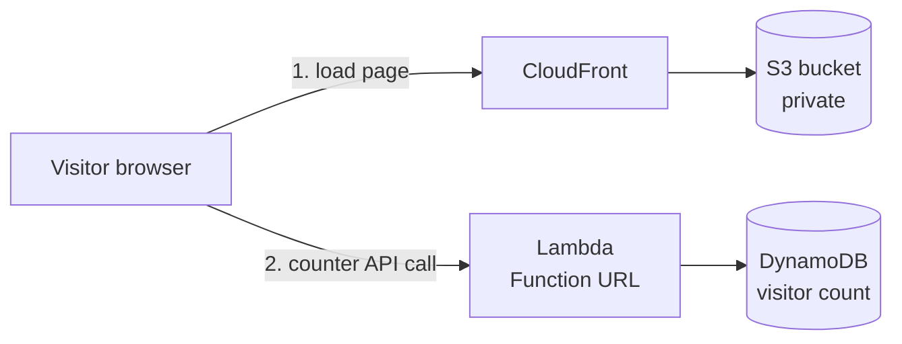
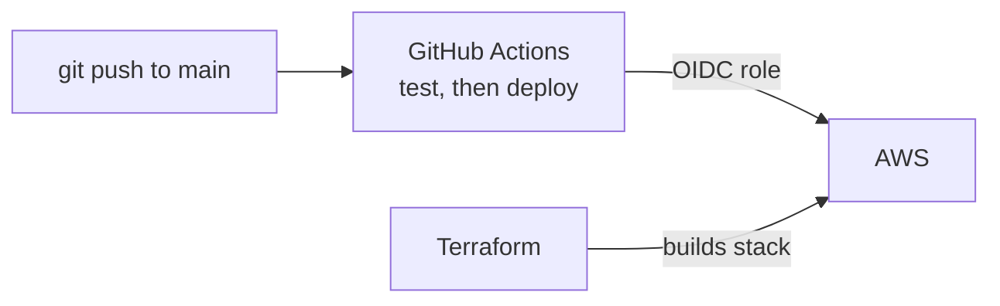
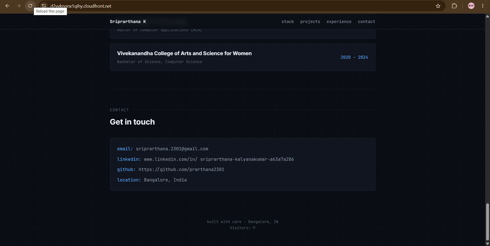
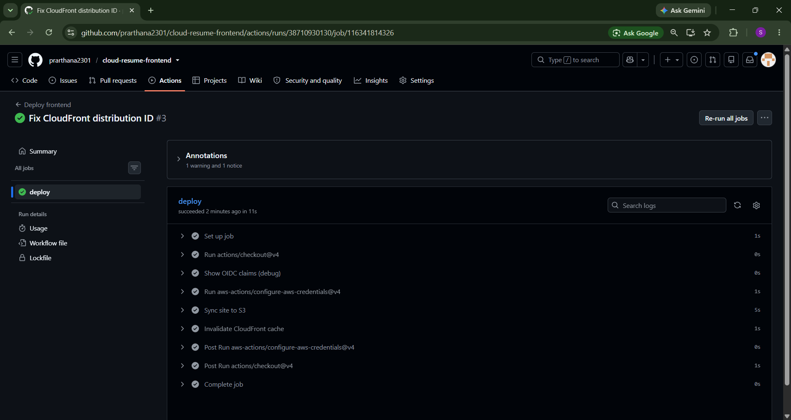
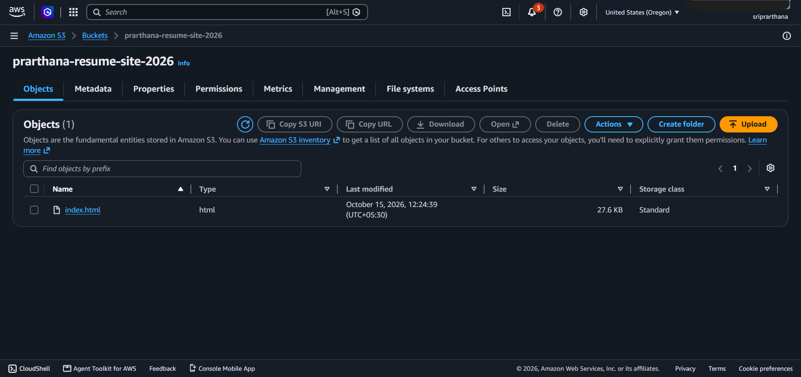
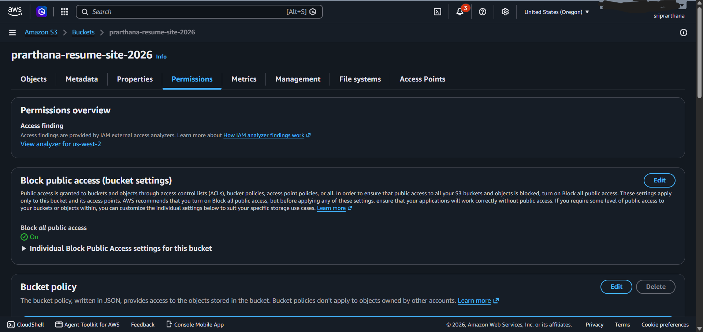
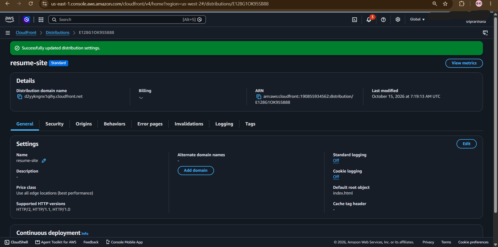
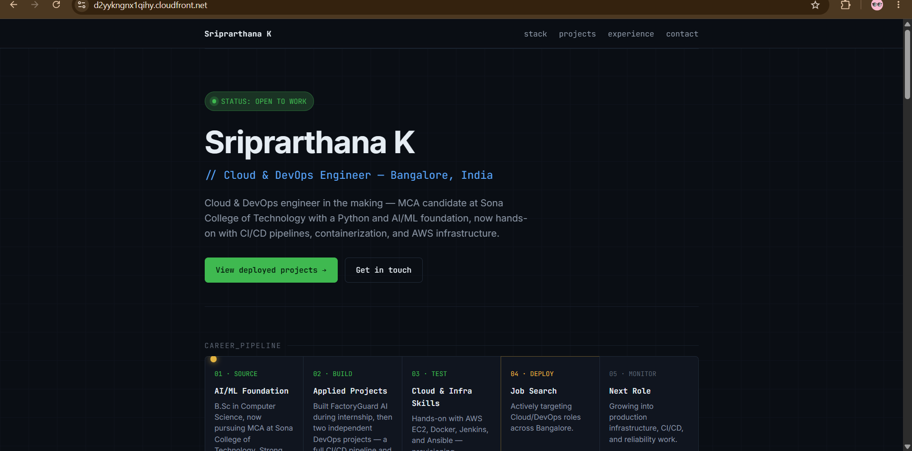

# Cloud Resume Challenge: Frontend

My portfolio, hosted on AWS with a serverless visitor counter and deployed automatically on every push.

**Live site:** https://d2yykngnx1qihy.cloudfront.net

## Architecture

## What it does

- Serves the portfolio over HTTPS from a **private S3 bucket** through **CloudFront**, using Origin Access Control so the bucket is never public
- A small script on the page calls a **Lambda function URL**, which adds 1 to a counter in **DynamoDB** and returns the number shown in the footer
- Every push to `main` deploys automatically: the files sync to S3 and the CloudFront cache is cleared

## Tech stack

AWS S3, CloudFront, Lambda (Python), DynamoDB, IAM, GitHub Actions (OIDC), Terraform, pytest

## Repositories

- [cloud-resume-frontend](https://github.com/prarthana2301/cloud-resume-frontend): this repo, the site and its deploy pipeline
- [cloud-resume-backend](https://github.com/prarthana2301/cloud-resume-backend): Lambda code, tests and deploy pipeline
- [cloud-resume-infra](https://github.com/prarthana2301/cloud-resume-infra): Terraform for the whole stack

## Deployment pipeline

The workflow in `.github/workflows/deploy.yml` runs on every push to `main`:

1. Signs in to AWS with short-lived credentials through OIDC
2. Syncs the site files to the S3 bucket
3. Invalidates the CloudFront cache so visitors see the new version

## Security decisions

- **No stored AWS keys.** GitHub Actions authenticates with short-lived credentials through OIDC. The deploy role only trusts this repo's `main` branch.
- **Least privilege.** The deploy role can only write to one bucket and invalidate one distribution.
- **Private bucket.** Only my CloudFront distribution can read it.
- **CORS locked down** to the site's own domain on the counter API.

## Problems I solved

- **The OIDC role would not assume.** GitHub's token `sub` claim included numeric owner and repo IDs, so my trust policy never matched. I added a debug step that printed the real claims, then updated the trust policy to match.
- **`NoSuchDistribution` in the pipeline.** I had mixed up the letter O and the number 0 in the CloudFront distribution ID. Now I copy IDs from the console instead of retyping them.
- **Two copies of `index.html`.** I uploaded an old copy to S3 by hand while a newer one lived in the repo. That is why the deploy pipeline exists now: the repo is the single source of truth.

## Screenshots

| Live site with visitor counter | Deploy pipeline (green) |
|---|---|
|  |  |

| Private S3 bucket | Public access blocked |
|---|---|
|  |  |

| CloudFront distribution | Portfolio |
|---|---|
|  |  |

## What I would add next

- A custom domain with Route 53 and an ACM certificate
- Monitoring and alarms with CloudWatch
- Counting unique visitors instead of every page load