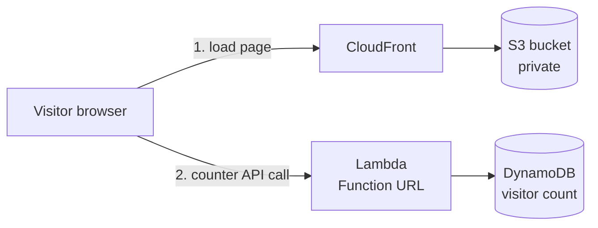
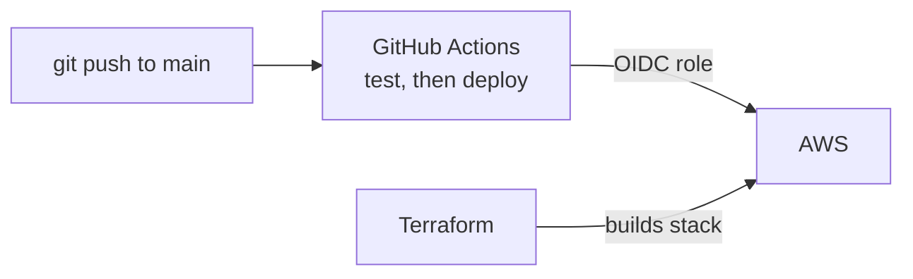

# Cloud Resume Challenge

My portfolio, hosted on AWS with a serverless visitor counter, built as a full cloud project.

**Live site:** https://d2yykngnx1qihy.cloudfront.net

## Architecture

## Deployment

## Repositories

- [cloud-resume-frontend](https://github.com/prarthana2301/cloud-resume-frontend): this repo, the static site and its deploy pipeline
- [cloud-resume-backend](https://github.com/prarthana2301/cloud-resume-backend): Lambda code, pytest tests and deploy pipeline
- [cloud-resume-infra](https://github.com/prarthana2301/cloud-resume-infra): Terraform for the whole stack# cloud-resume-frontend